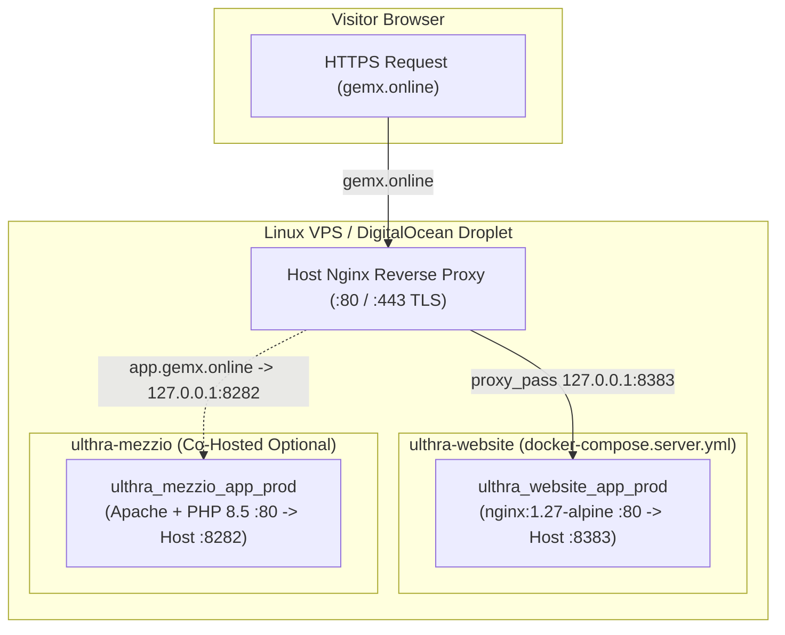

# gemX Website (`ulthra-website`) — Production Deployment & Operations Guide

This guide provides the end-to-end instructions, Docker Compose workflows, reverse-proxy setup, and operational checks required to build, deploy, and maintain the **gemX** marketing & product showcase website (`ulthra-website`) across local, staging, and production servers—mirroring the deployment workflow of **`ulthra-mezzio`**.

---

## Table of Contents

1. [Architecture & Container Overview](#1-architecture--container-overview)
2. [Prerequisites & Server Sizing](#2-prerequisites--server-sizing)
3. [Quick Start: Docker Deployment](#3-quick-start-docker-deployment)
4. [Production Deployment Scenarios](#4-production-deployment-scenarios)
   - [Scenario A: Co-Hosted on the Same VPS Alongside `ulthra-mezzio` (Recommended)](#scenario-a-co-hosted-on-the-same-vps-alongside-ulthra-mezzio-recommended)
   - [Scenario B: Dedicated Droplet / Standalone Server](#scenario-b-dedicated-droplet--standalone-server)
5. [Environment Variables Reference (`.env`)](#5-environment-variables-reference-env)
6. [Nginx Container Routing, Caching & Security (`docker/nginx/default.conf`)](#6-nginx-container-routing-caching--security-dockernginxdefaultconf)
7. [Reverse Proxy & SSL/TLS Setup (Cloudflare & Let's Encrypt)](#7-reverse-proxy--ssltls-setup-cloudflare--lets-encrypt)
8. [Post-Deployment Verification & Smoke Tests](#8-post-deployment-verification--smoke-tests)
9. [Updating, Logs & Troubleshooting](#9-updating-logs--troubleshooting)

---

## 1. Architecture & Container Overview

`ulthra-website` uses a **multi-stage `Dockerfile`** so Node.js and build toolchains never ship into the production runtime image:

1. **Stage 1 (`builder` — `node:22-alpine`)**: Installs locked dependencies (`npm ci`), type-checks TypeScript (`tsc -b`), and compiles the optimized Vite production bundle into `/app/dist`.
2. **Stage 2 (`production` — `nginx:1.27-alpine`)**: Copies only the compiled static assets (~150 KB gzipped) and [`docker/nginx/default.conf`](docker/nginx/default.conf) into a tiny Alpine Nginx container (~45 MB total image size) with built-in `/healthz` probes, Gzip compression, immutable asset caching, and SPA history routing.



### Container & File Inventory

| File / Service | Container Name | Runtime Image | Internal Port | Default Host Port | Purpose |
| :--- | :--- | :--- | :---: | :---: | :--- |
| [`docker-compose.yml`](docker-compose.yml) (`app`) | `ulthra_website_app` | `nginx:1.27-alpine` | `80` | `8383` | Local / staging production-mode preview |
| [`docker-compose.yml`](docker-compose.yml) (`dev`) | `ulthra_website_dev` | `node:22-alpine` | `4321` | `4321` | Optional containerized Vite HMR dev server (`--profile dev`) |
| [`docker-compose.server.yml`](docker-compose.server.yml) (`app`) | `ulthra_website_app_prod` | `nginx:1.27-alpine` | `80` | `8383` | Production server deployment (`restart: always`, log rotation, `./logs` mount) |
| [`deploy.sh`](deploy.sh) | — | Bash CLI | — | — | One-command production build, startup & status check |
| [`docker/setup-nginx-proxy.sh`](docker/setup-nginx-proxy.sh) | — | Bash CLI | — | `80` / `443` | Configures host Nginx reverse proxy + TLS vhost without clashing with `ulthra-mezzio` |

---

## 2. Prerequisites & Server Sizing

Because the production container serves pre-compiled static bundles via `nginx:1.27-alpine`, its resource footprint is minimal (~15–30 MB RAM idle):

- **Co-Hosted Alongside `ulthra-mezzio`**: Zero extra VM required—runs comfortably on the same Droplet/VM using port `8383` (while `ulthra-mezzio` uses `8282`).
- **Standalone Dedicated Droplet**: 1 vCPU, 1 GB RAM, 25 GB SSD (Ubuntu 22.04 / 24.04 LTS or Debian 12 / 13).
- **Software Requirements**:
  - Docker Engine `24.0+`
  - Docker Compose plugin `v2.20+` (`docker compose version`)
  - Host Nginx `1.24+` (recommended when terminating TLS or sharing ports `80`/`443` across multiple domains)

---

## 3. Quick Start: Docker Deployment

### Local / Staging Docker Run (`docker-compose.yml`)

```bash
cd ulthra-website
cp .env.example .env
docker compose up -d --build
```

- **Website URL**: `http://localhost:8383`
- **Healthcheck URL**: `http://localhost:8383/healthz`

*(Optional)* To run the interactive Vite HMR development server inside Docker instead of locally installed Node:

```bash
docker compose --profile dev up
# Opens on http://localhost:4321
```

### One-Command Production Server Deploy (`./deploy.sh`)

Just like `ulthra-mezzio/deploy.sh`, you can build and launch the production stack with a single command:

```bash
cd ulthra-website
./deploy.sh
```

---

## 4. Production Deployment Scenarios

### Scenario A: Co-Hosted on the Same VPS Alongside `ulthra-mezzio` (Recommended)

When hosting both the marketing website (`gemx.online`) and the HRIS application (`app.gemx.online`) on the same server:

1. **Configure `.env` to bind locally on port `8383`**:
   ```bash
   cd /opt/PayrollHand/ulthra-website
   cp .env.example .env
   ```
   Edit `.env`:
   ```dotenv
   PORT=8383
   BIND_ADDR=127.0.0.1
   DOMAIN=gemx.online
   ```

2. **Build and launch the production container**:
   ```bash
   ./deploy.sh
   ```

3. **Provision the Host Nginx Reverse Proxy vhost**:
   ```bash
   ./docker/setup-nginx-proxy.sh gemx.online 8383
   ```
   This creates `/etc/nginx/sites-available/gemx.online.conf` forwarding port `80`/`443` traffic for `gemx.online` (and `www.gemx.online`) to `http://127.0.0.1:8383` without touching your existing `ulthra-mezzio` Nginx vhost on `127.0.0.1:8282`.

---

### Scenario B: Dedicated Droplet / Standalone Server

If deploying `ulthra-website` onto its own dedicated VM without any other web apps on port `80`:

#### Option 1 — Behind Host Nginx + TLS (Recommended for HTTPS)
Keep `BIND_ADDR=127.0.0.1` and `PORT=8383` in `.env`, run `./deploy.sh`, and run `./docker/setup-nginx-proxy.sh gemx.online 8383` (plus `sudo certbot --nginx -d gemx.online -d www.gemx.online` if not using Cloudflare Origin/Full SSL).

#### Option 2 — Direct Container Binding on Port `80` (Behind Cloud Load Balancer)
If SSL/TLS is terminated upstream by a DigitalOcean Load Balancer or Cloudflare Tunnel:
```dotenv
PORT=80
BIND_ADDR=0.0.0.0
```
Then run:
```bash
./deploy.sh
```

---

## 5. Environment Variables Reference (`.env`)

| Variable | Default | Description |
| :--- | :--- | :--- |
| `PORT` | `8383` | Host TCP port mapped to Nginx port `80` inside the container (`8383` avoids colliding with `ulthra-mezzio`'s `8282`) |
| `BIND_ADDR` | `0.0.0.0` | Host interface bound in `docker-compose.server.yml`. Set to `127.0.0.1` when behind host Nginx so port `8383` is not exposed directly |
| `DEV_PORT` | `4321` | Host TCP port for the optional `dev` profile container (`docker compose --profile dev up`) |
| `DOMAIN` | `gemx.online` | Default domain passed to `./docker/setup-nginx-proxy.sh` |

---

## 6. Nginx Container Routing, Caching & Security (`docker/nginx/default.conf`)

Inside the container, [`docker/nginx/default.conf`](docker/nginx/default.conf) enforces best practices tailored for a multi-route React + Vite application:

- **React Router SPA Fallback (`try_files $uri $uri/ /index.html;`)**:
  Ensures direct browser visits and page refreshes on deep routes—such as `/products/payroll`, `/products/core-hr`, `/features/multi-company`, `/features/self-service`, `/roi-calculator`, and `/request-demo`—always return `200 OK` instead of `404`.
- **Zero-Stale Deployments + Immutable Asset Caching**:
  - `/index.html` is served with `Cache-Control: no-cache, no-store, must-revalidate` so browsers immediately pick up newly deployed releases.
  - `/assets/*` (content-hashed JS/CSS chunks) are served with `Cache-Control: public, max-age=31536000, immutable`.
  - `/img/*` and favicons (`.webp`, `.png`, `.ico`) are cached for 7 days (`max-age=604800`).
- **Health Probe (`/healthz`)**:
  Returns `200 OK` (`ok`) with `access_log off` so Docker healthchecks and DigitalOcean Load Balancers do not pollute access logs.
- **Security Headers**:
  Sends `X-Frame-Options: SAMEORIGIN`, `X-Content-Type-Options: nosniff`, `Referrer-Policy: strict-origin-when-cross-origin`, `Permissions-Policy`, and `server_tokens off`.

---

## 7. Reverse Proxy & SSL/TLS Setup (Cloudflare & Let's Encrypt)

### Using Cloudflare (Full / Full Strict SSL)
1. Run `./docker/setup-nginx-proxy.sh gemx.online 8383` on the server.
2. Point your Cloudflare DNS `A` records (`@` and `www`) to the server's public IP with Proxy (`Orange Cloud`) enabled and SSL/TLS mode set to **Full** (or install a Cloudflare Origin Certificate at `/etc/nginx/ssl/gemx.online.crt` and `.key` for **Full (Strict)**).

### Using Let's Encrypt (Certbot Direct TLS)
If DNS is unproxied (`Grey Cloud` or non-Cloudflare DNS):
```bash
./docker/setup-nginx-proxy.sh gemx.online 8383
sudo apt-get install -y certbot python3-certbot-nginx
sudo certbot --nginx -d gemx.online -d www.gemx.online --redirect
```

---

## 8. Post-Deployment Verification & Smoke Tests

Run these checks right after `./deploy.sh` to verify every layer:

### 1. Container Status & Healthcheck
```bash
docker compose -f docker-compose.server.yml ps
```
Expected status: `ulthra_website_app_prod` → `Up ... (healthy)`.

### 2. Health Endpoint, Home Route & Deep SPA Route Checks
```bash
PORT="${PORT:-8383}"

# Healthcheck endpoint (expect 200)
curl -fsS -o /dev/null -w "healthz: %{http_code}\n" "http://127.0.0.1:${PORT}/healthz"

# Home page (expect 200)
curl -fsS -o /dev/null -w "home: %{http_code}\n" "http://127.0.0.1:${PORT}/"

# Deep React Router pages (expect 200 via SPA fallback)
curl -fsS -o /dev/null -w "payroll-page: %{http_code}\n" "http://127.0.0.1:${PORT}/products/payroll"
curl -fsS -o /dev/null -w "multi-company: %{http_code}\n" "http://127.0.0.1:${PORT}/features/multi-company"
curl -fsS -o /dev/null -w "roi-calculator: %{http_code}\n" "http://127.0.0.1:${PORT}/roi-calculator"

# Official Day & Night gemX WebP logos (expect 200)
curl -fsS -o /dev/null -w "logo-light: %{http_code}\n" "http://127.0.0.1:${PORT}/img/logo/gemx-payroll-logo-light.webp"
curl -fsS -o /dev/null -w "logo-dark: %{http_code}\n" "http://127.0.0.1:${PORT}/img/logo/gemx-payroll-logo.webp"
```

---

## 9. Updating, Logs & Troubleshooting

### Deploying Code or Copy Updates
Pull the latest branch changes and re-run `./deploy.sh`:
```bash
git pull origin feature/end-to-end-hris
./deploy.sh
```
Docker rebuilds the Vite bundle in Stage 1 and swaps `ulthra_website_app_prod` in ~1–2 seconds.

### Viewing Logs
```bash
# Live container stdout/stderr logs
docker compose -f docker-compose.server.yml logs -f app

# Persisted Nginx logs on the host
tail -f logs/access.log logs/error.log
```

### Stopping or Restarting the Stack
```bash
# Restart production container
docker compose -f docker-compose.server.yml restart

# Stop and remove production container
docker compose -f docker-compose.server.yml down
```

### Common Troubleshooting

1. **`Bind for 0.0.0.0:8383 failed: port is already allocated`**
   - Change `PORT=` in `.env` to another free port (e.g. `PORT=8384`), re-run `./deploy.sh`, and update the port passed to `./docker/setup-nginx-proxy.sh`.
2. **`404 Not Found` when refreshing `/products/payroll`**
   - Confirm requests are hitting the `ulthra_website_app_prod` container (which includes `try_files $uri $uri/ /index.html;` in `docker/nginx/default.conf`) rather than pointing host Nginx directly at a raw directory without `try_files`.
3. **Browser shows an older cached version after deployment**
   - `/index.html` already sends `Cache-Control: no-cache, no-store, must-revalidate`. If Cloudflare caching rules were customized to "Cache Everything", purge Cloudflare cache or set Cloudflare Cache Level to **Standard** so `/index.html` honors origin `Cache-Control` headers.

